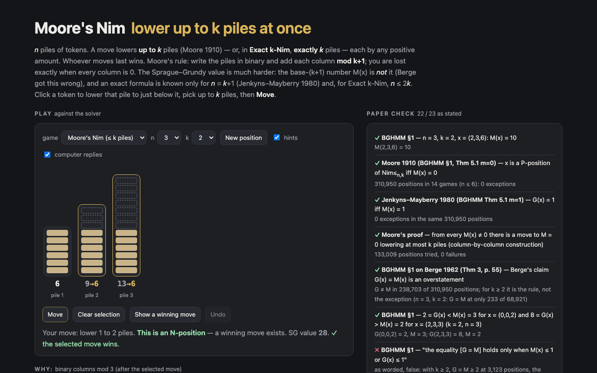

# Moore's Nim

A browser implementation of **Moore's Nim<sub>k</sub>** and **Exact k-Nim**, played against an exact solver. It also recomputes the checkable claims of two papers on these games by exhaustive search.



There are *n* piles of tokens. A move lowers **1 to *k*** piles (Moore's Nim, E. H. Moore 1910) or **exactly *k*** piles (Exact k-Nim). Each chosen pile drops by any positive amount. Whoever makes the last move wins. With *k* = 1 both games are ordinary Nim.

- **Moore's rule.** Write the piles in binary and add each column **mod k+1**. A position is lost (a P-position) exactly when every column is 0. The demo shows this table live, and the computer finds its winning move with Moore's column-by-column construction: starting at the top bit, it clears or sets bits in at most *k* piles.
- **The Sprague–Grundy value is a different story.** The column sums, read as a base-(k+1) number M(x), are *not* the SG value. Berge (1962) claimed they were. The exact SG value is known only in a few cases:
  - Moore's Nim with *n* = *k*+1: the Jenkyns–Mayberry formula (1980).
  - Exact k-Nim with *n* < 2*k*: the SG value equals the **Tetris function** T, the length of the longest possible game.
  - Exact k-Nim with *n* = 2*k*: a formula of Boros–Gurvich–Ho–Makino–Mursič. It is the Jenkyns–Mayberry formula again, with T in place of Σx.

  The demo uses each formula where it applies. For Exact k-Nim with *n* > 2*k*, where the problem is open, it uses memoised search instead.
- **Paper check.** `npm run verify` solves every position with piles up to a bound B in 28 games, using one forward sweep in mixed radix (about 45 s). It then checks 23 statements, listed below.

## What the check finds

Sources:

- [BGHMM] E. Boros, V. Gurvich, N. B. Ho, K. Makino, P. Mursič, *On the Sprague-Grundy function of Exact k-Nim*, [arXiv:1508.04484](https://arxiv.org/abs/1508.04484) (Discrete Applied Mathematics 2018).
- [BGKM] E. Boros, V. Gurvich, L. Kitrossky, K. Makino, *On the Sprague-Grundy function of compound games*, [arXiv:1903.08138](https://arxiv.org/abs/1903.08138).

All statements were transcribed from the TeX sources.

| claim | result |
|---|---|
| Moore: P-positions are exactly M(x) = 0; JM: 1-positions are exactly M(x) = 1 (BGHMM Theorem 3) | 0 exceptions in 310,950 positions across 14 Moore games, n ≤ 6 |
| Berge's G = M is an overstatement; G(0,0,2) = 2 < M = 3, G(2,3,3) = 8 > M = 2 | confirmed. For k ≥ 2, G ≠ M is the norm: with n = 3, k = 2, G = M holds at only 233 of 68,921 positions |
| "the equality holds **only when** M(x) ≤ 1 or G(x) ≤ 1" | **false as worded**. With 2 ≤ k < n there are 3,112 positions where G = M ≥ 2; the smallest is (0,1,1), with G = M = 2. The statement holds in the "if" direction only |
| Jenkyns–Mayberry formula for Nim≤<sub>k+1,k</sub> (BGKM eq. (1)–(2), h = Σx) | 0 exceptions in 129,914 positions with n = 3..6. Like BGHMM Theorem 2, it needs k ≥ 2: in 2-pile Nim it is wrong at 3,272 of 4,096 positions |
| the formula is for n = k+1 only | it fails in every other Moore game tried |
| BGHMM Theorem 1: n < 2k gives G = T | 0 exceptions in 306,737 positions across 6 games |
| BGHMM Theorem 2 (n = 2k) and Corollary 1 (0- and 1-positions) | 0 exceptions in 183,185 positions. The printed u/m/y/z/v form is identical to U(m, T(x − m), T(x)) |
| BGHMM Theorem 4 (O(n) Tetris), Lemmas 3 and 7, Figures 1 and 6 (x̄ = (0,0,0,5,5,6,7)) | 0 exceptions in 489,922 positions |
| BGKM Theorem 2: the SG value of the selective compound of two 3-pile Moore games is U(m₁+m₂, y₁+y₂, h₁+h₂) | 0 exceptions in 46,656 positions |
| BGKM Example 2 | G(a) = 4, and all 4 moves to SG 2 raise a component's SG, as claimed. The target "(3,3,4)" must be read up to order: (4,4,5) → (3,3,4) would lower all three piles, which is not a legal move. The real targets are (3,4,3) and (4,3,3) |

For the open case, Exact k-Nim with n > 2k, the report lists the P-positions of Nim=<sub>5,2</sub>, Nim=<sub>6,2</sub> and Nim=<sub>7,3</sub>. It also measures how often the n ≤ 2k formulas still give the right value: 70–91 % of positions.

`runs/verify.json` holds the full report.

## Run

```sh
npm install
npm run dev        # demo at http://localhost:5173/portfolio/moores-nim/
npm test           # 12 tests
npm run verify     # paper check (about 45 s), writes runs/verify.json
npm run build
```

`src/nim.ts` holds the whole game with no dependencies: Moore's M(x) and winning move, the JM formula, three implementations of the Tetris function (the paper's O(n) x̄, greedy, and the volume criterion), the Exact k-Nim formulas, a move enumerator, the exhaustive grid solver, and memoised search.

## License

MIT © 2026 SEN LLC
